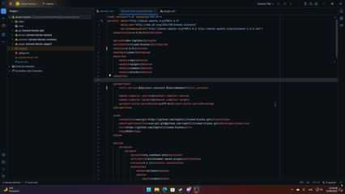

# ClosedBlocks

ClosedBlocks is a minecraft plugin which adds multiple blocks with different funcionalities to your
minecraft server. Compatible with multiple plugins which add custom blocks (i.e [ItemsAdder](https://www.spigotmc.org/resources/%E2%9C%A8itemsadder%E2%AD%90emotes-mobs-items-armors-hud-gui-emojis-blocks-wings-hats-liquids.73355/)) and highly
customizable.

## How to install

Installing ClosedBlocks is extremely easy. First of all, make sure you are using a spigot/paper at least for minecraft 1.21 and that you have java 21 installed.
After that, download the resource from where you purcharsed it, and simply drag it into your plugins folder.

## Compiling from source

ClosedBlocks follows a freemium model, in where you can compile the plugin source code yourself and start using the plugin for free, with the only drawback of no
official support. This means that, any bug, or issue that happens while using a self-compiled version of the plugin will be ignored and won't be fixed.

> [!WARNING]
> The plugin is licensed under [AGPL v3](https://www.gnu.org/licenses/agpl-3.0.en.html#license-text). This means that any modification or re-distribution of the
> plugin must be also open-source and have the exact same license.

### Using an IDE (recommended)

Using an IDE is the most recommended option as they usually provide ways of compiling a maven project with less effort that it would require doing it manually. The
recommended IDE is [JetBrains IntellIJ](https://www.jetbrains.com/idea/download/#community-edition) or [Eclipse IDE](https://www.eclipse.org/downloads/). We do not 
recommend using [Visual Studio Code](https://code.visualstudio.com/) as it is not an IDE, regardless of their extense extension environment which provides supports to java maven projects.

If you are using an IDE, all you need to do is to clone the repository `git clone https://github.com/tagfull/closed-blocks.git` and then open the `closed-blocks` directory
using your IDE. The IDE should automatically detect the maven project, and allow you to easily build it without much effort.

For instance, in jetbrains IDE, your only task is to, after importing the project (or directly cloning from git), is to click on the maven button in the toolbar (displayed
as an "m"), then click on `closed-blocks -> Lifecycle` and then select `clean` and `deploy` tasks. After that, click on the green arrow pointing to the right button, and the
project should start to compile automatically.


### Without an IDE

If for some reason you can't run an IDE (i.e running a terminal environment), building the project is still possible, all you need to do is to manually download at least
java 21 jdk, a very recommended option is to use [Azul Zulu OpenJDK 21](https://www.azul.com/downloads/?version=java-21-lts&package=jdk#zulu).

After you have downloaded and installed the JDK, you need to [download maven](https://maven.apache.org/download.cgi#Files) and add it to the path.

As a last step, and after making sure you have both tools installed (by running `java -version` and `mvn --version`) you can then
navigate to the directory in where you cloned the repository and compile the project using `mvn` command

```bash
cd ./closed-blocks
mvn clean deploy
cd spigot/target
cp closedblocks-spigot-X.Y.Z.jar <output>
```

### Warranty disclaimer (self-compiled & official)

THE SOFTWARE IS PROVIDED "AS IS", WITHOUT WARRANTY OF ANY KIND, EXPRESS OR
IMPLIED, INCLUDING BUT NOT LIMITED TO THE WARRANTIES OF MERCHANTABILITY,
FITNESS FOR A PARTICULAR PURPOSE AND NONINFRINGEMENT. IN NO EVENT SHALL THE
AUTHORS OR COPYRIGHT HOLDERS BE LIABLE FOR ANY CLAIM, DAMAGES OR OTHER
LIABILITY, WHETHER IN AN ACTION OF CONTRACT, TORT OR OTHERWISE, ARISING FROM,
OUT OF OR IN CONNECTION WITH THE SOFTWARE OR THE USE OR OTHER DEALINGS IN THE
SOFTWARE.

> [!NOTE]
> The compiled version (AKA official) is provided as a pre-compiled binary of the open-source version. With the difference
> some parts of its code might vary for the user who purchased it. Said that, the pre-compiled version of ClosedBlocks is
> not under [AGPL v3](https://www.gnu.org/licenses/agpl-3.0.en.html#license-text), instead, it has proprietary rights and
> it's under the [ClosedBlocks EULA](./EULA.txt). When purchasing the product, you automatically accept that, you are and
> will be responsible for fulfilling the EULA statements, without taking advantage of or looking for legal loopholes in it.
> The user is also responsible for checking the EULA after product updates or after EULA specified "expiration time". The
> user also accepts its knowledge in the fact that, when the EULA expires, it's conditions will still be applied until a
> new EULA version is released, as the EULA expiration time only indicates a time period in where the "previous" EULA is
> still valid until that expiration time is reached, in which case, the user must accept the new EULA in order to keep using
> the product.